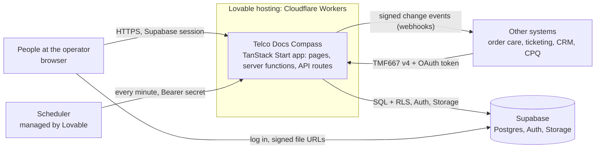
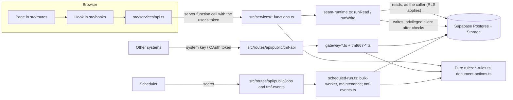
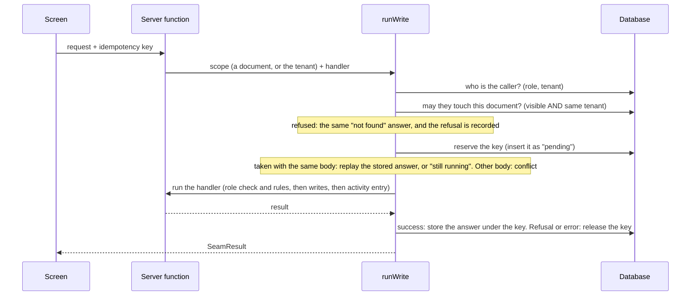
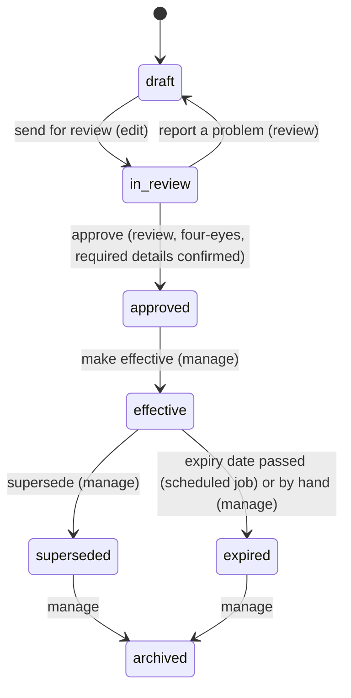
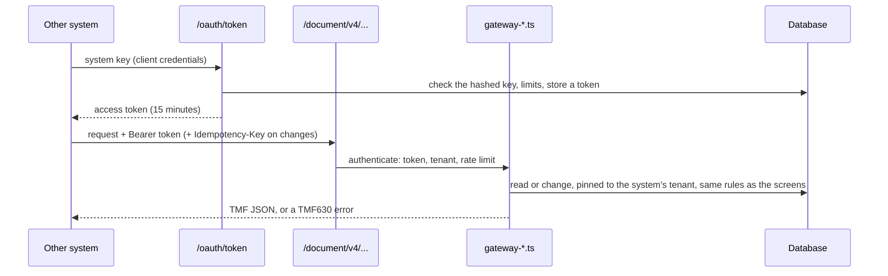
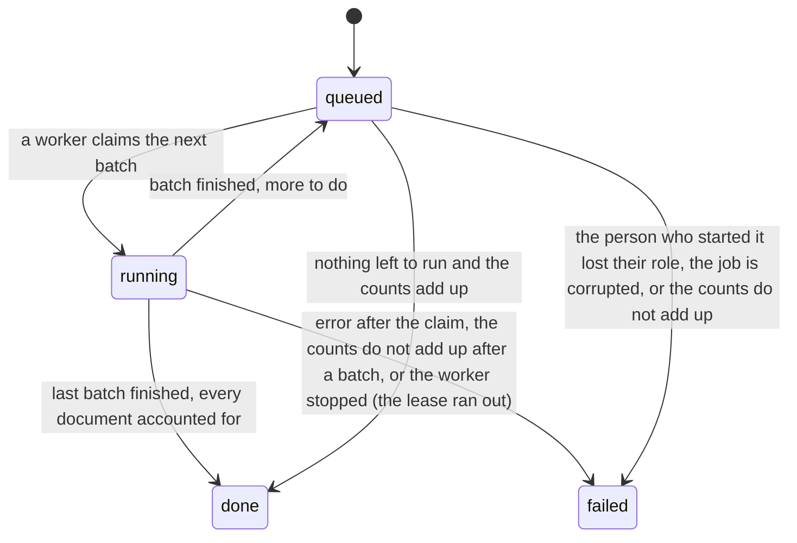
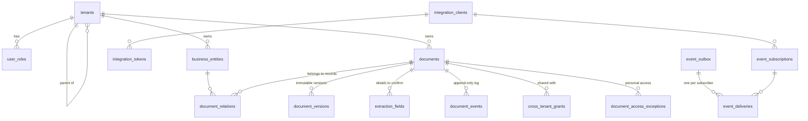

# Architecture

What the system is made of, how a request travels through it, and how data and access are modelled. Where each file lives and where a change goes is in `docs/architecture/code-organization.md`. The reason behind a decision is in `docs/decisions/`. The rules a change must keep are in `.kiro/steering/invariants.md`.

## System context

- **People** use the web app. They log in with Supabase Auth (email and password). Their session token goes with every server call.
- **Other systems** use the public TMF667 API with a system key, exchanged for a short-lived OAuth token. They can subscribe to change events, which the app signs (`X-Signature`) and posts to them.
- **The scheduler** calls two protected routes every minute: background work and event delivery.
- **Supabase** holds everything: the Postgres database (with row-level security, SQL functions and triggers), the accounts, and the files (one Storage bucket, `documents`). The app is stateless apart from a few per-instance limits kept in memory.

How it is built and hosted: `docs/operations/deployment.md`.

## Runtime pieces

One deployable app, one database. Inside the app there are four kinds of entry point:

| Entry point | Code | Who calls it | Authenticated by |
| --- | --- | --- | --- |
| Pages (server-rendered shell, then a client app) | `src/routes/*.tsx`, `src/routes/_authenticated/*.tsx` | people, in the browser | Supabase session; `_authenticated/route.tsx` redirects to `/auth` without one |
| Server functions (the "seam") | `src/services/*.functions.ts` | the pages, through `src/services/api.ts` | `requireSupabaseAuth` middleware checks the session token |
| Public API | `src/routes/api/public/tmf-api/**` | other systems | system key, then OAuth bearer token (`gateway-core.ts`, `gateway-token.ts`) |
| Scheduled routes | `src/routes/api/public/jobs/bulk-documents.ts`, `src/routes/api/public/tmf-events/deliver.ts` | the scheduler | Bearer secret (`src/integrations/supabase/cron-auth.ts`) |

All four call the same service code in `src/services/`, which applies the same pure rules.

## The layers

- **Screens never touch the database.** A page uses a hook, the hook calls `src/services/api.ts` (the only door to the backend), and `api.ts` calls a server function. The browser attaches the user's token to every server function call (`src/integrations/supabase/auth-attacher.ts`); the server checks it (`auth-middleware.ts`). The one exception is the file upload itself: the server hands out a signed upload address and the browser sends the file straight to Storage.
- **Server functions return `SeamResult`** (`{ ok, data }` or `{ ok: false, error }`). `api.ts` turns a failure into a typed `SeamFailure` the screen can show. Error codes map to user text in `src/lib/document-labels.ts`.
- **Rules are pure functions** with no I/O, called by the screens (to decide what to show), the server functions, the TMF gateway and the workers. That is why "can this person approve?" has one answer everywhere.
- **Reads run as the caller**, so row-level security does the filtering. **Writes use the privileged client**, but only after `runWrite` has checked visibility, tenant and idempotency and the handler has checked the role. Each write records its own activity entry.
- **Three entry points write**: screens (through `runWrite`), the TMF API (through the `gateway-*.ts` files, pinned to the key's tenant) and bulk changes (`bulk-worker.ts`, pinned to the job's tenant). A business rule is applied at each of them: see "Adding or changing a rule about a document" below.

## How a read travels

1. The page renders and its hook asks TanStack Query for data, for example `api.searchDocuments(...)`.
2. `api.ts` calls the server function. On the server, `requireSupabaseAuth` builds a database client that carries the caller's token.
3. The function calls `runRead`, which loads the caller's role and tenant, runs the query as the caller and logs one line (`op`, tenant, outcome, time).
4. Postgres applies row-level security (`can_see_document` and the policies in `drizzle/migrations/`), so a row the person may not see is simply not returned.
5. Search across many documents uses SQL functions (`search_documents`, `count_documents`, `facet_documents`) built on one access filter, `_doc_search_where`, which follows the same rule as `can_see_document`.
6. File downloads: the server checks access and returns a short-lived signed Storage address.

## How a write travels

`runWrite` (`src/services/seam-runtime.ts`) is the single door for writes from screens. The order is always the same:

The key is reserved before the work runs, so two requests with the same key arriving together do the work once (`idempotency-claim.ts`). Every write checks the database answer (`must()`), and an update that follows a check only applies if the row still looks the way it was read (`updateDocumentIf`), so a change made in between is never overwritten. The activity entry is part of the change: if it cannot be written, the change is reported as failed.

Seeing a document through a share from another tenant is not the same as being allowed to change it: the tenant check is separate from visibility. Failed access checks return a uniform "not found".

## Document lifecycle

The forward moves are `ALLOWED_TRANSITIONS` in `document-rules.ts`; sending back from review is `reportProblem`, not a transition. Approved and effective documents keep their confirmed details, dates and file versions (`contentProtected`), while name, description, sensitivity, external ids and links stay editable (`metadataPatchAllowed`). Superseded, expired and archived documents are frozen. Deletion is separate from the status: a soft delete (with restore), then permanent deletion by an admin, both blocked by a legal hold and the keep-until date.

## One change end to end: approving a document

1. A reviewer presses Approve in the document panel (`src/components/documents/document-actions-bar.tsx`) or at the end of the check-details page (`src/routes/_authenticated/records.$entityId_.review.$docId.tsx`). The button is offered only when `document-actions.ts` says so, with the reason text otherwise.
2. The hook `useDocumentActions` (`src/hooks/use-document-actions.ts`) calls `api.transition({ id, to: "approved" })`. `api.ts` adds a fresh idempotency key and calls the server function.
3. `transition` in `document-status.functions.ts` runs `runWrite` with `scope: { kind: "doc", id }`: caller's role and tenant, the document is visible and in the same tenant, the key is reserved.
4. The handler checks the role (`can(role, transitionCapability("approved"))`, reviewer and above), the move (`isTransitionAllowed`), then `approvalRefusal` in `document-approval.ts`: four-eyes first, then the required details.
5. `updateDocumentIf` sets the status only if it is still `in_review`; if someone moved it first, the answer is a refused move, not an overwrite. `audit` writes the `statusChange` activity entry.
6. A database trigger adds a `DocumentStateChangeEvent` to `event_outbox`. The next scheduled delivery pass (`tmf-events.ts`) sends it, signed, to each subscription of that tenant whose filter matches.
7. The answer goes back as `SeamResult`; the hook refreshes the record list and the document, and shows a toast. A refusal shows the text for its code from `src/lib/document-labels.ts`.

The same approval from another system goes through `POST /document/{id}/transition`, `transitionDocument` in `gateway-changes.ts`, and the same `approvalRefusal`; from a bulk change through `bulkSkipReason` and `bulk-worker.ts`.

## Adding a document

1. The person drops files on a record. The screen checks type and size with the rule the server also uses (`typeRefusal` in `upload-rules.ts`).
2. A server function registers the document and its first version and returns a signed upload address. The browser uploads the file to Storage.
3. Scanning and reading the details are simulated in this prototype (`pipeline.functions.ts`, see `docs/decisions/2026-11-10-upload-pipeline-simulation.md`). The read details land in `extraction_fields` for a person to confirm.
4. The document then follows the status path. Approval checks four-eyes and the required details (`document-approval.ts`).

## Documents for other systems (TMF667)

Routes under `src/routes/api/public/tmf-api/` are thin. `gateway-core.ts` (`authenticate`) checks the token first, pins every query to that system's tenant, applies the per-system rate limit, and then uses the same pure rules as the screens. `tmf667-mapper.ts` maps our internal lifecycle to TMF status and event names. The standard path is `document/v4`; `documentManagement/v4` is a legacy alias. The contract is `contracts/seams/tmf667-document.openapi.yaml`. Details: `src/routes/api/public/tmf-api/AGENTS.md`; the guide for teams connecting a system is `docs/integration/tmf667-api.md`.

Limits on what a caller can make the server do (constants in the files named; all of them in `docs/architecture/limits.md`):
- Request bodies and fetched files are read up to a limit, never in full: 50 KB for ordinary bodies, about 7 MB for a registration with inline content, 4 KB for the token request, 25 MB for a file fetched from an address (`gateway-body.ts`, `gateway-create-input.ts`, `gateway-fetch.ts`). A body over the limit is answered 413.
- Token requests are limited per caller address, per system, and by the number of tokens a system may hold at once; rotating or revoking a key removes its tokens (`gateway-token.ts`).

## Background work

- **Bulk changes** (`bulk-worker.ts`): a job lists document ids. Each pass takes one batch, re-checks every document with the rules of a single action (`bulkSkipReason` in `search-rules.ts`), and writes one activity entry per change. The job's `status` is its lease, so only one worker holds it at a time; the length is `BULK_LEASE_SECONDS`. Starting a job also runs its first batch inline.
- **Events for other systems** (`tmf-events.ts`): a database trigger writes an event to `event_outbox` for each create, delete, status change, and hold, version or details change (`drizzle/migrations/0007_migration.sql`); the bulk worker adds one `DocumentBatchEvent` per batch itself. A pass fans each event out to one `event_deliveries` row per matching subscription, then claims due rows, signs the body and posts it. A failed read leaves work pending; a failing subscriber is retried on its own with backoff, then given up on (dead-letter, see the runbook). Delivery is at least once: receivers must deduplicate by `X-Event-Id`. The file events (`DocumentFileStoredEvent`, `DocumentFileReadyToReadEvent`, `DocumentFilePurgedEvent`) come from the same trigger (migrations 0016–0019) when a document enters scanning or reading, or is purged; they reach only subscriptions that name them, with whitelisted facts under `event.file`. A legal hold change is a change event naming `legalHold`, without its value.
- **The organisation's own antivirus and reader** (file hooks): when the organisation turns a step on (`tenants.external_processing`), a step that starts waits for its designated key (one per kind, migration 0020) instead of the built-in simulated check. The system downloads the version during its step, then answers `scanResult` or `extractionResult`; every answer is checked against the step, attempt, version and hash, and written guarded like any processing step (`file-result-target.ts`). The timeout sweep in the scheduled run fails steps nobody answered (`file-hook-sweep.ts`).
- **Housekeeping** (`maintenance.ts`): after the bulk pass, the same scheduled call expires documents past their expiry date (one activity event each), fails uploads and outside steps that waited too long (file hooks), and removes old idempotency keys and expired access tokens. It never runs inside a person's request, because it touches every tenant. If the scheduler stops, bulk changes stop advancing; expiry has a safety net (`expiry-fallback.ts`): opening a document list expires the reader's own tenant's due documents, at most once a minute per tenant.
- The scheduled passes are routes under `src/routes/api/public/`, protected by a secret (`src/integrations/supabase/cron-auth.ts`) and meant to be called by a scheduler that is configured outside this repository. What their answers mean: `docs/operations/runbook.md`.

## Tenancy and access

- **Tenants form a tree**: a group (the master tenant) with country tenants below it. Every row has a `tenant_id`. A person has one role in one tenant (`user_roles`).
- **The group** manages shared document types, locks and minimums for its countries, and reads their settings and document counts. It never reads their documents (`docs/decisions/2026-11-10-tenant-model.md`). Countries inherit or override settings within those locks (`tenant-rules.ts`).
- **Seeing a document** (`can_see_document`): it is not deleted, and either it is in your tenant and you are the tenant admin, have access to a record it belongs to (`entity_access`) or have a personal exception that has not expired; or it was shared with your tenant (`cross_tenant_grants`) and the share is not revoked or expired.
- **Changing a document** needs the role and the same tenant. A share lets another tenant see, never change. Inside the tenant, someone who reaches a document only through a share is capped by its level. Sharing scenarios with examples: `docs/architecture/sharing.md`.

| Role | Can (each role includes the ones above it) |
| --- | --- |
| `viewer` | read and download what they can see |
| `contributor` | add documents, edit details, send for review (`edit`) |
| `reviewer` | confirm details, approve (`review`), never their own document |
| `manager` | make effective, supersede, expire, archive, place and release holds, share and unshare, delete, and restore a deleted document on a record they have access to (`manage`) |
| `tenant_admin` | everything in the tenant, plus permanent deletion, connected systems and tenant settings |
| `master_admin` | the group: shared document types, locks, minimums, counts of the countries, and the test-data reset |

The capability checks are `can()` and `transitionCapability()` in `document-rules.ts`; what a person sees on screen comes from `document-actions.ts`.

## Data model

| Table | Holds |
| --- | --- |
| `tenants`, `user_roles`, `profiles` | Organisations, who has which role where, people |
| `business_entities`, `entity_access`, `document_relations` | The records, who may see them, and which documents belong to them |
| `documents`, `document_versions`, `extraction_fields` | A document, its immutable versions, the details read from it and their review state |
| `document_events` | The activity log: append-only, written by the operation itself, never carries detail values |
| `cross_tenant_grants`, `document_access_exceptions` | Sharing and exceptions to inherited access |
| `document_specifications`, `retention_policies` | Document types and policies, inherited from the group |
| `idempotency_keys` | Stored answers of writes, so a repeated request is not applied twice |
| `bulk_jobs`, `saved_views` | Bulk changes and saved searches |
| `integration_clients`, `integration_tokens`, `api_rate` | Connected systems, their keys and tokens, and request counts |
| `event_outbox`, `event_subscriptions`, `event_deliveries` | Change events, who listens, and each delivery attempt |

A document's type is a code (`documents.document_type`) that matches a document specification of the tenant or its group, not a foreign key. The schema is SQL in `drizzle/migrations/` (with `drizzle/schema.ts`), owned by Lovable. The TypeScript types are generated into `src/integrations/supabase/types.ts`. Database triggers keep versions and the activity log immutable. The document model is also described as JSON Schema in `contracts/model/`.

## Cross-cutting concerns

- **Errors.** Server code never throws to a screen: it returns a `SeamError` with a code, a category (`validation`, `notFound`, `conflict`, `rejected`, `unavailable`, `unknown`) and the next action for the person. Database errors become "unavailable", never "no rows" (`shared/must.ts`). The API answers TMF630 error bodies.
- **Logging.** One JSON line per operation with an `op` name, tenant, document id, outcome code and time. Never document names, details, reasons or database text. Repeated access refusals are logged at a capped rate.
- **Idempotency.** Every change takes an idempotency key: screens make a fresh one per action (`newIdempotencyKey` in `api.ts`), other systems send `Idempotency-Key`.
- **Concurrency.** Conditional updates (`updateDocumentIf`), claimed keys, and leases on bulk jobs and deliveries. No in-process locks.
- **Security.** Controls and how they were checked: `docs/architecture/security-baseline.md`.
- **Accessibility.** WCAG 2.2 AA target, ERAD primitives, `aria-disabled` with a visible reason: `docs/architecture/accessibility.md`.
- **Design system.** ERAD tokens in `src/styles/tokens.css`, utilities in `src/styles.css`, primitives in `src/components/erad/`.
- **Limits.** Every size, batch and lifetime, with its reason: `docs/architecture/limits.md`.

## Adding or changing a rule about a document

A rule such as "approval is blocked when X" lives in more than one entry point. Check each one, and add a case to the parity test (`src/services/__tests__/rule-parity.test.ts`):

1. The pure rule (`document-rules.ts` or `review-rules.ts`) and its test.
2. What the screen shows: `document-actions.ts`, `review-flow-rules.ts`.
3. The server function that enforces it: the handler in the matching `document-*.functions.ts` file.
4. The TMF API: `applyTransition` and the related functions in `gateway-changes.ts`.
5. Bulk changes: `bulkSkipReason` in `search-rules.ts` and `bulk-worker.ts`.

## Known limits

- Row-level security, SQL functions and triggers are SQL in `drizzle/migrations/`, not TypeScript. Unit tests use an in-memory stand-in that cannot enforce them; the opt-in access tests (`RUN_ACCESS_TESTS=1`) check the read side against the real backend.
- Files in `src/services` stay under 300 lines (`src/test/repo-hygiene.test.ts`); none is over today.
- A change and its activity entry are two writes, not one transaction. If the entry fails, the change is reported as failed but may already be saved. Making them one needs a database function (a request to the owner).
- Limits kept in memory are per server instance (see `docs/decisions/2026-11-17-runs-on-lovable-workers.md`).
- Scanning and reading of uploaded files are simulated.
- Conformance with TM Forum is not claimed until the official test kit has been run.
