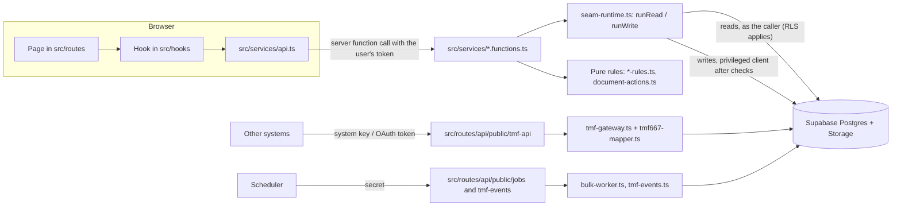
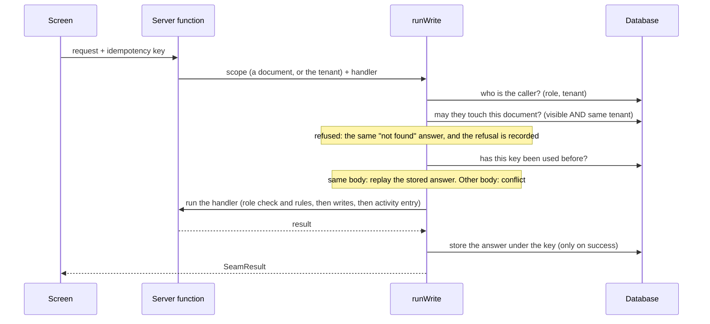
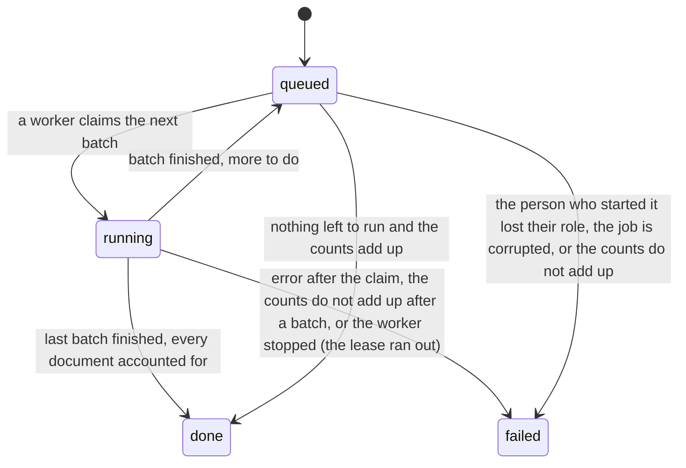

# Architecture

How the code is organised and how a request travels through it. For the reason behind a decision, see `docs/decisions/`. For the rules a change must keep, see `.kiro/steering/invariants.md`.

## The layers

- **Screens never touch the database.** A page uses a hook, the hook calls `src/services/api.ts` (the only door to the backend), and `api.ts` calls a server function. The browser attaches the user's token to every server function call (`src/integrations/supabase/auth-attacher.ts`); the server checks it (`auth-middleware.ts`).
- **Server functions return `SeamResult`** (`{ ok, data }` or `{ ok: false, error }`). `api.ts` turns a failure into a typed error the screen can show.
- **Rules are pure functions** with no I/O, called by the screens (to decide what to show), the server functions, the TMF gateway and the workers. That is why "can this person approve?" has one answer everywhere.
- **Reads run as the caller**, so row-level security does the filtering. **Writes use the privileged client**, but only after `runWrite` has checked visibility, tenant and idempotency and the handler has checked the role. Each write records its own activity entry.
- **Three entry points write**: screens (through `runWrite`), the TMF API (through `tmf-gateway.ts`, pinned to the key's tenant) and bulk changes (`bulk-worker.ts`, pinned to the job's tenant). A business rule is applied at each of them: see "Adding or changing a rule about a document" below.

## How a write travels

`runWrite` (`src/services/seam-runtime.ts`) is the single door for writes. The order is always the same:

Seeing a document through a share from another tenant is not the same as being allowed to change it: the tenant check is separate from visibility. Failed access checks return a uniform "not found".

## Background work

- **Bulk changes** (`bulk-worker.ts`): a job lists document ids. Each pass takes one batch, re-checks every document with the rules of a single action (`bulkSkipReason` in `search-rules.ts`), and writes one activity entry per change. The job's `status` is its lease, so only one worker holds it at a time; the length is `BULK_LEASE_SECONDS`. Starting a job also runs its first batch inline.
- **Events for other systems** (`tmf-events.ts`): a database trigger writes an event to `event_outbox` for each create, delete, status change, and hold, version or details change (`drizzle/migrations/0007_migration.sql`); the bulk worker adds one `DocumentBatchEvent` per batch itself. A pass fans each event out to one `event_deliveries` row per matching subscription, then claims due rows, signs the body and posts it. A failed read leaves work pending; a failing subscriber is retried on its own with backoff. Delivery is at least once: receivers must deduplicate by `X-Event-Id`.
- **Housekeeping** (`maintenance.ts`): after the bulk pass, the same scheduled call expires documents past their expiry date (one activity event each) and removes old idempotency keys and expired access tokens. It never runs inside a person's request, because it touches every tenant. If the scheduler stops, documents stop expiring and bulk changes stop advancing.
- The scheduled passes are routes under `src/routes/api/public/`, protected by a secret (`src/integrations/supabase/cron-auth.ts`) and meant to be called by a scheduler that is configured outside this repository.

## Documents for other systems (TMF667)

Routes under `src/routes/api/public/tmf-api/` are thin. `tmf-gateway.ts` checks the system key first, pins every query to that key's tenant, applies the per-system rate limit, and then uses the same pure rules as the screens. `tmf667-mapper.ts` maps our internal lifecycle to TMF status and event names. The standard path is `document/v4`; `documentManagement/v4` is a legacy alias. Details: `src/routes/api/public/tmf-api/AGENTS.md`.

Limits on what a caller can make the server do (constants in the files named):
- Request bodies and fetched files are read up to a limit, never in full: 50 KB for ordinary bodies, about 7 MB for a registration with inline content, 4 KB for the token request, 25 MB for a file fetched from an address (`gateway-body.ts`, `gateway-create-input.ts`, `gateway-fetch.ts`). A body over the limit is answered 413.
- Token requests are limited per caller address, per system, and by the number of tokens a system may hold at once; rotating or revoking a key removes its tokens (`gateway-token.ts`).

## I want to change... where do I look?

| I want to change | Look at |
| --- | --- |
| Who may do what (roles) | `can()` and `transitionCapability()` in `src/services/document-rules.ts` |
| The status path | `ALLOWED_TRANSITIONS` in `src/services/document-rules.ts` |
| Which buttons a person sees and the reason text | `src/services/document-actions.ts` |
| The check-details journey and the approve gate | `review-flow-rules.ts`, `review-rules.ts`, and `pendingRequiredDetails` in `document-rules.ts` |
| Upload rules (types, size, duplicates) | `src/services/upload-rules.ts`; the simulated pipeline is in `pipeline.functions.ts` |
| Search, filters, bulk changes | `search-rules.ts`, `search.functions.ts`, `bulk-worker.ts` |
| Legal holds, deletion, restore | `setHold`, `deleteDocument`, `restoreDeleted` in `document-write.functions.ts`; the same in `tmf-gateway.ts`; button states in `document-actions.ts` |
| Holds and retention overview, permanent deletion, expiry | `retention.functions.ts` |
| Group and country settings | `tenant-rules.ts`, `tenant-config.functions.ts` |
| The API other systems use | `src/services/tmf-gateway.ts`, `tmf667-mapper.ts`, `contracts/seams/tmf667-document.openapi.yaml` |
| Rate limits per system | `rate-limit-rules.ts` (the rule), `integration-clients.functions.ts` (where an admin sets them) |
| Event delivery and retries | `event-delivery-rules.ts`, `tmf-events.ts` |
| The order of checks for every write | `src/services/seam-runtime.ts` |
| A screen | the route in `src/routes/_authenticated/` (for example `documents.tsx`) and the components it imports from `src/components/<area>/` |
| Colours, spacing, tokens | `src/styles/tokens.css` and `src/styles.css` |
| The database | Ask the owner: `drizzle/` is managed by Lovable |

## Main tables

| Table | Holds |
| --- | --- |
| `tenants`, `user_roles`, `profiles` | Organisations, who has which role where, people |
| `business_entities`, `document_relations` | The records and which documents belong to them |
| `documents`, `document_versions`, `extraction_fields` | A document, its immutable versions, the details read from it and their review state |
| `document_events` | The activity log: append-only, written by the operation itself, never carries detail values |
| `cross_tenant_grants`, `document_access_exceptions`, `entity_access` | Sharing and exceptions to inherited access |
| `document_specifications`, `retention_policies` | Document types and policies, inherited from the group |
| `idempotency_keys` | Stored answers of writes, so a repeated request is not applied twice |
| `bulk_jobs`, `saved_views` | Bulk changes and saved searches |
| `integration_clients`, `integration_tokens`, `api_rate` | Connected systems, their keys and tokens, and request counts |
| `event_outbox`, `event_subscriptions`, `event_deliveries` | Change events, who listens, and each delivery attempt |

## Adding or changing a rule about a document

A rule such as "approval is blocked when X" lives in more than one entry point. Check each one, and add a case to the parity test when it exists:

1. The pure rule (`document-rules.ts` or `review-rules.ts`) and its test.
2. What the screen shows: `document-actions.ts`, `review-flow-rules.ts`.
3. The server function that enforces it: the handler in `document-write.functions.ts`.
4. The TMF API: `applyTransition` and the related functions in `tmf-gateway.ts`.
5. Bulk changes: `bulkSkipReason` in `search-rules.ts` and `bulk-worker.ts`.

## Known limits

- Row-level security, SQL functions and triggers are SQL in `drizzle/migrations/`, not TypeScript. Unit tests use an in-memory stand-in that cannot enforce them; the opt-in access tests (`RUN_ACCESS_TESTS=1`) check the read side against the real backend.
- Several files are still large. They are listed in `src/test/repo-hygiene.test.ts` and may not grow.
- Conformance with TM Forum is not claimed until the official test kit has been run.
