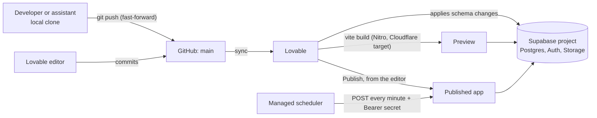

# Deployment

How the app is built, configured, hosted and published today, and what has to change to run it in an internal environment. It names no project, address or secret value: look those up in Lovable. Day-to-day operation is in `docs/operations/runbook.md`.

## Today: hosted by Lovable

- **Source of truth** is `main` on GitHub. Lovable and this repository sync both ways: edits in the Lovable editor become commits, and commits pushed to `main` show up in Lovable.
- **Build.** `vite build` with `@lovable.dev/vite-tanstack-config`, which includes TanStack Start, React, Tailwind and Nitro with Cloudflare Workers as the default target. The output is `.output/` (not committed): static assets in `.output/public` and the Worker in `.output/server`, with the `wrangler.json` Nitro writes. The server entry is `src/server.ts`. Run `bun run build` locally to see the same output.
- **Runtime.** Cloudflare Workers: no file system, no long-running process, no private network. The app keeps no state between requests apart from a few per-instance limits in memory (`docs/decisions/2026-11-17-runs-on-lovable-workers.md`).
- **Backend.** One Supabase project (Lovable Cloud) holds the database, the accounts and the files. The repository is connected to that one project; the preview and the published app use it.
- **Schema.** Lovable applies the migrations in `drizzle/migrations/` (`drizzle.config.ts` reads the connection from `LOVABLE_DB_MIGRATION_URL`, which Lovable provides). Nobody runs migrations by hand, and nobody edits `drizzle/` or `supabase/` in this repository: ask for the change in Lovable.

## Configuration

Names are in `.env.example`. Values live in Lovable, never in the repository.

| Variable | Read by | Kind |
| --- | --- | --- |
| `VITE_SUPABASE_URL`, `VITE_SUPABASE_PUBLISHABLE_KEY`, `VITE_SUPABASE_PROJECT_ID` | the browser (built into the bundle) | public |
| `SUPABASE_URL`, `SUPABASE_PUBLISHABLE_KEY`, `SUPABASE_PROJECT_ID` | the server, for requests made as the caller | public |
| `SUPABASE_SERVICE_ROLE_KEY` | the server only (`client.server.ts`), for writes after the app's own checks | secret |
| `LOVABLE_CRON_SECRET` | the scheduled routes (`cron-auth.ts`) | secret |
| `LOVABLE_CRON_SECRET_PREVIOUS` | the same, during a rotation | secret, optional |

- `.env` is tracked because Lovable manages and regenerates it. It only holds the public values. The publishable key is public by design; row-level security protects the data.
- Secrets are set as secrets in Lovable. A missing service-role key shows up as `Missing Supabase environment variable(s)` in the server log, and privileged writes fail.
- **Rotating the scheduler secret**: set the new value as `LOVABLE_CRON_SECRET` and the old one as `LOVABLE_CRON_SECRET_PREVIOUS` (both are accepted), switch the scheduler to the new value, then remove the previous one.
- Rotating the service-role key is done in the Supabase project and then in Lovable's secrets, together.

## Scheduled calls

Two routes, both `POST`, both with `Authorization: Bearer <scheduler secret>`, every minute:

| Route | Does |
| --- | --- |
| `/api/public/jobs/bulk-documents` | advances bulk changes, then expiry and cleanup (`runScheduled`) |
| `/api/public/tmf-events/deliver` | fans out and delivers change events to subscribers (`deliverPending`) |

The scheduler is configured in Lovable, not in this repository. Without it, bulk changes do not advance and events are not delivered; expiry still happens when someone opens a document list. What the answers mean and what to do when a run fails: `docs/operations/runbook.md`.

## Publishing a change

1. Make the change on a branch. `bun run check` must pass; for a change to access, tenants or database functions, also `RUN_ACCESS_TESTS=1 bun run test`.
2. Push to `main` as a fast-forward. Never force-push or amend published commits: Lovable keeps the history and would lose it.
3. Lovable syncs and rebuilds the preview. Run `docs/operations/regression-after-publish.md` against the preview: the privileged paths can only be tested there.
4. Publish from the Lovable editor to update the live app.
5. To undo, revert the commit in a new commit and push it. Do not reset `main`.

A schema change is made in Lovable first. Pull it, adjust the code to the regenerated types, then follow the same steps.

## Environments

| Environment | What runs | Backend | Privileged writes |
| --- | --- | --- | --- |
| Local (`bun run dev`) | the app from your clone | the connected Supabase project, with your demo sign-in | no (the service-role key is not available locally) |
| Preview | the latest `main`, built by Lovable | the connected Supabase project | yes |
| Published | the version last published from the editor | the connected Supabase project | yes |

Because they share one backend, e2e scripts create real rows marked "TMF test". Remove them with Admin, "Reset test data" (group admin).

## Moving to an internal Ericsson environment

Not designed yet. The likely target is a Node server in a cluster with a managed or self-hosted Supabase (or Postgres plus equivalents for Auth and Storage). What is known to change:

| Area | Today | To do for the move |
| --- | --- | --- |
| Build target | Nitro, Cloudflare preset, set by `@lovable.dev/vite-tanstack-config` | Build for a Node server preset; this likely means owning the Vite and Nitro configuration instead of Lovable's |
| Outbound calls (callbacks, files by address) | checked host, but Workers cannot connect to the checked IP | Pin the checked IP when connecting, or send all outbound calls through an egress proxy with the same rules. Required, because the private network will be reachable |
| Limits kept in memory | per Worker instance, approximate | Move to a shared store if more than one instance runs |
| Scheduler | Lovable's managed scheduler | The platform's cron calling the same two routes with the same Bearer check |
| Secrets | Lovable secrets | The platform's secret store; no code change |
| Database schema | applied by Lovable | A migration pipeline that runs `drizzle/migrations/` in order, with the same review as code |
| Logs | JSON lines on stdout, read in Lovable | Ship stdout to the platform's log store; the lines carry no content |
| Source sync | GitHub `main` synced with Lovable | Decide whether Lovable stays in the loop; if not, the generated files become ours |

The reasoning is in `docs/decisions/2026-11-17-runs-on-lovable-workers.md`. Before going live anywhere real, the open items in `roadmap.md` (human security review, data that is not synthetic) apply.
