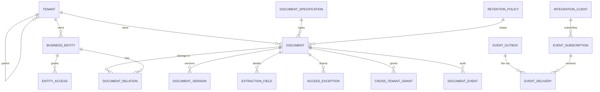
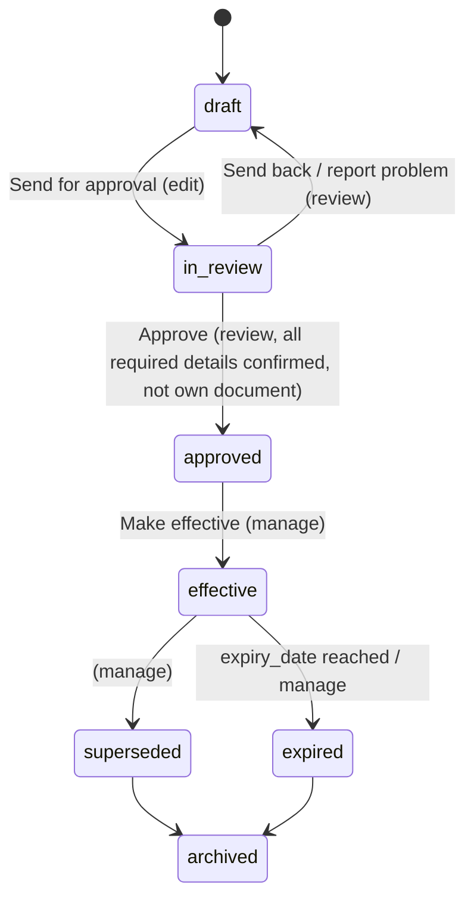
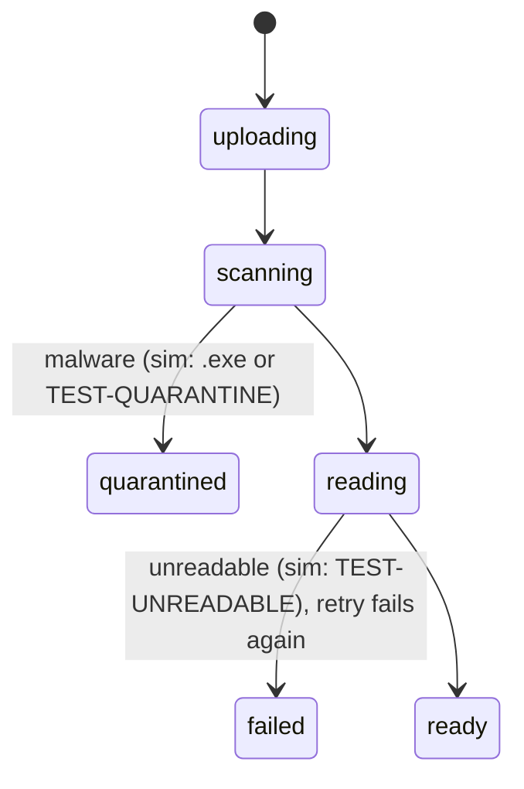

# 02 — Domain model

Ground truth: `reference/postgres-schema/*.sql` (current Postgres DDL) and `contracts/model/*.json`. The tables below are logical; `10-data-mapping-cassandra.md` maps them to Cassandra.

## Enums
| Enum | Values |
|---|---|
| doc_status | draft, in_review, approved, effective, superseded, expired, archived |
| pipeline_state | uploading, scanning, reading, ready, failed, quarantined |
| sensitivity | public, internal, confidential, restricted |
| signature_level | none, simple, advanced, qualified |
| app_role | viewer, contributor, reviewer, manager, tenant_admin, master_admin |
| access_level | view, edit, manage |
| extraction_status | pending, accepted, edited, rejected |
| referred_type (record) | Account, Quote, ProductOrder, Contract, Line, Customer (API shows Account as BillingAccount) |
| tenant.role | master, child |
| tenant.cross_tenant_share | off, explicitGrant |
| tenant.master_supervision | none, metadataOnly, auditOnGrant |
| specification.lifecycle_status | inDesign, active, retired |

## Entities
| Entity | Key fields | Notes |
|---|---|---|
| Tenant | id, display_name, role, parent_tenant_id, hard_floors{minRetentionDays, autoAcceptConfidenceAtLeast, requireMalwareScan}, inheritance{mode per area} | master has children |
| Profile | user_id, tenant_id, display_name | names shown inside the tenant only |
| UserRole | user_id (PK), tenant_id, role | one tenant, one role; master_admin only in a master tenant (trigger) |
| BusinessEntity (record) | id e.g. `ord-se-7731`, tenant_id, referred_type, display_name, status_label | status_label is the **source system's** status |
| EntityAccess | (entity_id, user_id), level | grants record and therefore document visibility |
| DocumentSpecification | id, tenant_id, code, name, version, lifecycle_status, locked, definition{specCharacteristic[], acceptedMimeTypes, maxSizeMb, requiresReview, signatureRequired, containsPersonalData, defaultSensitivity, retentionPolicyRef, businessProcess} | the effective view merges group and country |
| RetentionPolicy | id, tenant_id, code, name, retain_days, locked | |
| Document | id uuid, tenant_id, name(1–255), description, document_type, status, pipeline_state, pipeline_detail, sensitivity, signature_level, effective_date, valid_to, expiry_date, origin(uploaded/generated), bundle_id/role, retention_policy_id, retain_until, legal_hold, hold_reason, hold_set_by, hold_reference, characteristic[], current_version_id, created_by, created_at, updated_at, deleted_at, purged_at, external_identifier[] | soft delete via deleted_at, tombstone via purged_at |
| DocumentRelation | (document_id, entity_id, role), attached_on | many-to-many document↔record |
| DocumentVersion | id, document_id, label, is_named, note, mime_type, attachment_type, size_bytes, content_hash (required), storage_path `<tenant>/<version>`, supersedes, created_by/at | **immutable** |
| ExtractionField | id, document_id, version_id, name, value, original_value, confidence, band(high/medium/low), status, source{page, excerpt, box}, reviewed_by, reviewed_at | accepted and edited values are copied into document.characteristic |
| DocumentAccessException (share) | (document_id, user_id), level, granted_by, expires_at | explicit per-person share |
| CrossTenantGrant | (document_id, to_tenant), level, granted_by, expires_at, revoked_at | only when tenant.cross_tenant_share = explicitGrant |
| DocumentEvent (audit) | id (bigint), tenant_id, document_id, version_id, actor, action (view, download, share, statusChange, …), detail, created_at | **append-only**; never holds detail values |
| IdempotencyKey | key, tenant, request_hash, response, created_at | TTL 24h |
| SavedView | id, owner/tenant, name, filters, team flag | admins create team views |
| BulkJob | id, owner, action, params, total, changed, skipped{reason:n}, status | |
| IntegrationClient | id, tenant_id, name, system_kind, scopes[], key_prefix, key_hash, expires_at, revoked_at, read/write_limit_per_minute | |
| IntegrationToken | token_hash, client_id, expires_at | OAuth access token, 15 min |
| ApiRate | (client_id, kind, window_start), hits | per-minute counter |
| EventSubscription | id, tenant_id, client_id, callback, query, secret, created_at | TMF hub |
| EventOutbox | id, tenant_id, document_id, event_type, payload{lifecycleState, previous}, created_at | written by trigger on documents |
| EventDelivery | (event_id, subscription_id), tenant_id, attempts, next_attempt_at, locked_until, delivered_at, gave_up_at, last_status, last_error | one row per subscriber per event |

## Relationships

## Status path

superseded, expired and archived are **frozen**: details can't be edited.

## Processing (pipeline) path

While a file is `scanning` or `quarantined` its content is locked (internal `doc.content.locked`, TMF 409 `contentLocked`).
