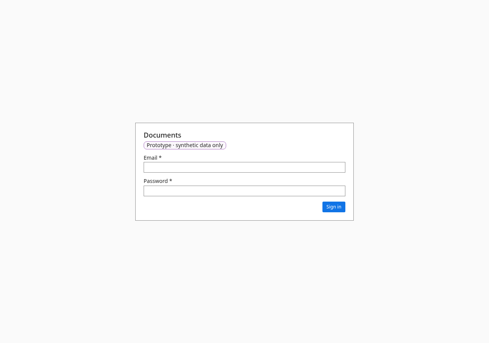

# Admin: holds and deletion

- **URL:** `/admin/holds`
- **Who:** admins

## Purpose
The same page as Holds and retention (see `holds.md`), reached from the Admin tabs so administrators have it without the manager navigation entry.

## Layout and actions
Identical to `holds.md`. Permanent deletion is not on this page: it lives in the document panel menu (`record.md`, BR-052–053). A master_admin on the group tenant sees document names of the group tenant here; whether invariant 2 applies to the group's own documents is the owner's decision.

## Accessibility
- Every action is reachable by keyboard. Unavailable actions use `aria-disabled` and show the reason as visible text.
- Dialogs return focus to the control that opened them. Targets are at least 24 px.
- Status is never shown by colour alone.

