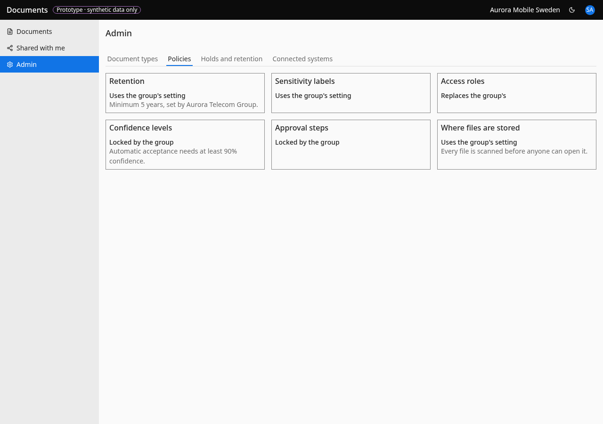

# Policies

- **URL:** `/admin/policies`
- **Who:** admins

## Purpose
Retention policies and the tenant's relation to group settings (BR-085), hard floors.

## Layout and actions
Read-only cards in a responsive grid: Retention, Sensitivity labels, Access roles, Confidence levels, Approval steps, Where files are stored. Each shows the BR-085 relation sentence and an optional note: Retention "Minimum N years, set by <group>."; Where files are stored "Every file is scanned before anyone can open it.". Retention days are changed per document type in Document types, not here. The Confidence levels card reads "Automatic acceptance needs at least 90% confidence." in the prototype (`policy-cards.tsx:9`, from the dormant `autoAcceptConfidenceAtLeast` floor): this contradicts invariant 6 and BR-023 and must not be ported as is; the replacement text and the meaning of the floor are the owner's decision.

## Accessibility
- Every action is reachable by keyboard. Unavailable actions use `aria-disabled` and show the reason as visible text.
- Dialogs return focus to the control that opened them. Targets are at least 24 px.
- Status is never shown by colour alone.

