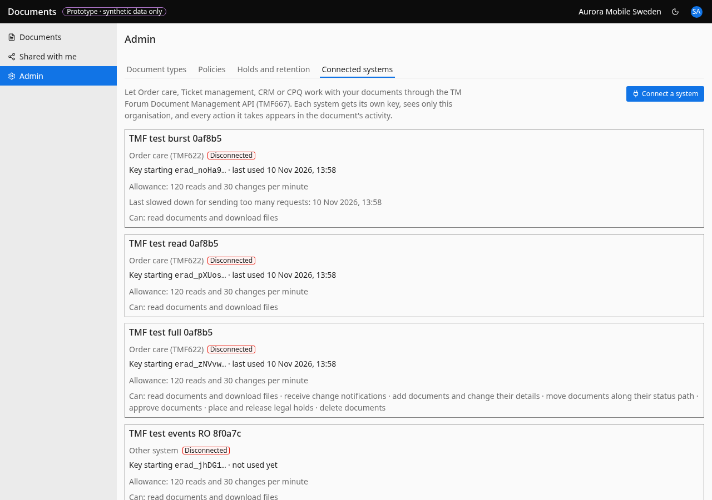
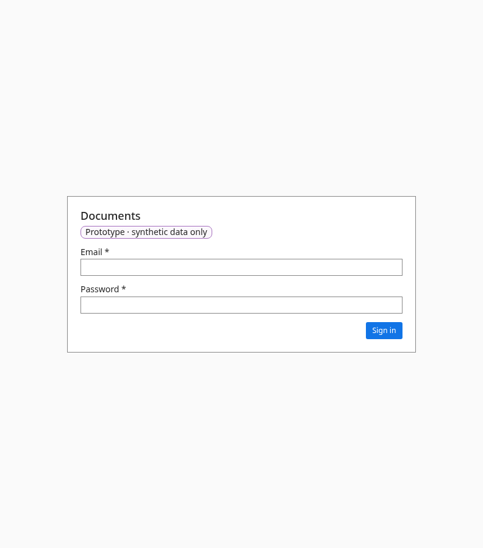

# Connected systems

- **URL:** `/admin/systems`
- **Who:** tenant_admin

## Purpose
Systems that use the TMF667 API (see 07).

## Layout and actions
Intro: "Let Order care, Ticket management, CRM or CPQ work with your documents through the TM Forum Document Management API (TMF667). Each system gets its own key, sees only this organisation, and every action it takes appears in the document's activity." Button **Connect a system** (name, kind, scopes) → key shown once with a copy button. Rotate, revoke, set per-minute read/change limits (BR-110) with bounds validation. Each card shows: name, kind (e.g. "Order care (TMF622)"), a Disconnected tag when revoked, "Key starting erad_… · last used <time>", "Allowance: N reads and M changes per minute", "Last slowed down for sending too many requests: <time>", and "Can: …" scopes written in plain words.

## Own antivirus and reader (file hooks)
Permissions "Check files for threats and report the result" (`scan`) and "Read details from files and report what it found" (`extract`) are grouped last under "Checking files and reading files each need a system of their own, with no other permission"; choosing one clears the others (and says so) and names the system Antivirus or Reader unless the name was changed. The name field explains "People see this name when a file waits for this system or is blocked by it." The card **Your own antivirus and reader** has one row per step with its mode (Own system or Built-in), what happens and a button named for the target. Turning a step on needs "I understand files will wait for this system" (or, with no system connected, a warning and "I understand files will fail after 30 minutes until a system is connected"); going back to the built-in check warns "protection is weaker" with a red button. Each change is recorded in the activity (`set_external_processing`). Disconnecting the system files wait for says that files already waiting fail after 30 minutes and new ones wait until another is connected.
## States
Empty: encouraging call to action to connect the first system.

## Accessibility
- Every action is reachable by keyboard. Unavailable actions use `aria-disabled` and show the reason as visible text.
- Dialogs return focus to the control that opened them. Targets are at least 24 px.
- Status is never shown by colour alone.

