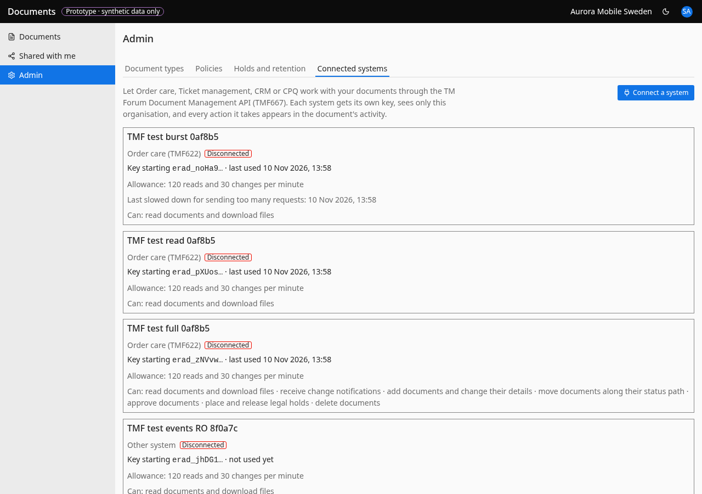

# Connected systems

- **URL:** `/admin/systems`
- **Who:** tenant_admin

## Purpose
Systems that use the TMF667 API (see 07).

## Layout and actions
Intro: "Let Order care, Ticket management, CRM or CPQ work with your documents through the TM Forum Document Management API (TMF667). Each system gets its own key, sees only this organisation, and every action it takes appears in the document's activity." Button **Connect a system** (name, kind, scopes) → key shown once with a copy button. Rotate, revoke, set per-minute read/change limits (BR-110) with bounds validation. Each card shows: name, kind (e.g. "Order care (TMF622)"), a Disconnected tag when revoked, "Key starting erad_… · last used <time>", "Allowance: N reads and M changes per minute", "Last slowed down for sending too many requests: <time>", and "Can: …" scopes written in plain words.

## States
Loading: "Loading connected systems…". Error: "We couldn't load connected systems just now." + Try again. Empty: "No systems connected yet" / "Connect Order care first so it can fetch the approved contract for any order in one call.". Key lifetime: "Key valid until <date>" / "Key expires <date>. How about issuing a new key now?" (within 30 days; `text-main` with a major tag or icon, not `text-status-major` as the prototype does, 3.52:1) / "This key has expired. You can issue a new key to reconnect.". Dialogs: "Connect a system" (reasons "Give the system a name." / "Choose at least one thing it can do."; Cancel / "Connect and show key"), "Copy this key now" / "This is the only time the key for <name> is shown. Store it in that system's secure settings." (Copy → "Key copied."; "I've stored it"), "Request limits for <name>" (bounds error "Choose a whole number from A to B."; Cancel / Save limits; toast "Request limits saved. They apply from the next request."), "Disconnect <name>?" / "Its key stops working straight away and its change notifications end. Documents it added stay where they are." (Keep connected / Disconnect). Note: OAuth tokens minted from a rotated key stay valid for up to 15 minutes in the prototype (`tmf-gateway.ts:79-84`); see 07. At 100+ systems (14) the card list is not enough; the list form is the owner's decision.

## Accessibility
- Every action is reachable by keyboard. Unavailable actions use `aria-disabled` and show the reason as visible text.
- Dialogs return focus to the control that opened them. Targets are at least 24 px.
- Status is never shown by colour alone.

