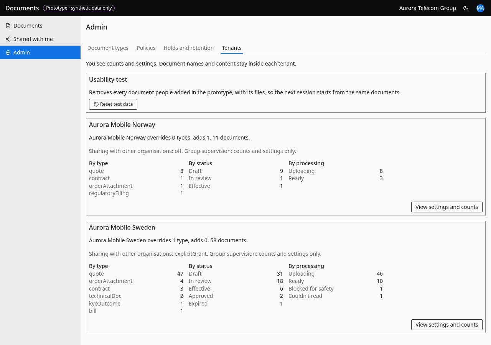
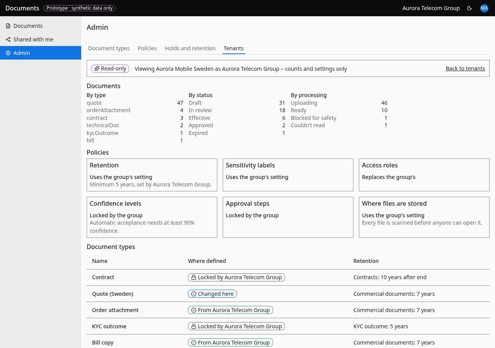

# Tenants (group)

- **URL:** `/admin/tenants and /admin/tenants/{tenantId}`
- **Who:** master_admin

## Purpose
Group view of its countries: counts only, plus settings (Documents count, Document types, Policies). Never document names (ADR-08).

## Layout and actions
"Back to tenants".

## States
Empty: "No organisations yet". Unknown or foreign tenant: "This organisation isn't available to you."

## Accessibility
- Every action is reachable by keyboard. Unavailable actions use `aria-disabled` and show the reason as visible text.
- Dialogs return focus to the control that opened them. Targets are at least 24 px.
- Status is never shown by colour alone.

