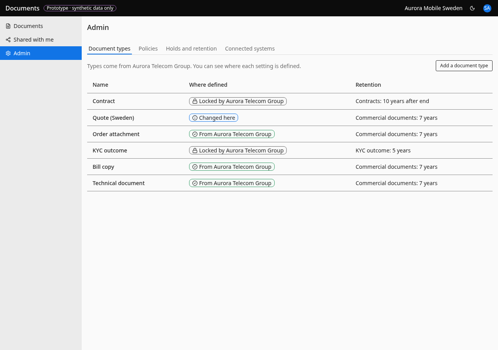

# Document types

- **URL:** `/admin/types`
- **Who:** admins

## Purpose
Document types (TMF667 DocumentSpecification): required details, accepted file types, size, review, signature, personal data, default sensitivity, retention, business process.

## Layout and actions
Table of types with a source tag (BR-084). Side panel to edit, with lock/extend/override rules (BR-081–083) and impact text (BR-086). "Add a document type" (Code, Name). "Unsaved changes" guard. Reset to the group version.

## States
Locked or extend-only reasons are shown next to the setting.

## Accessibility
- Every action is reachable by keyboard. Unavailable actions use `aria-disabled` and show the reason as visible text.
- Dialogs return focus to the control that opened them. Targets are at least 24 px.
- Status is never shown by colour alone.

