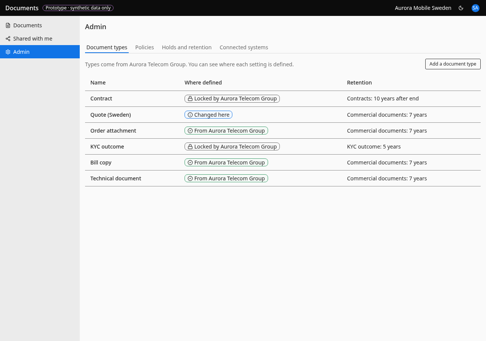

# Admin

- **URL:** `/admin (tabs: Document types, Policies, Holds and retention, Connected systems, Tenants)`
- **Who:** tenant_admin and master_admin (others: "Admin is for administrators")

## Purpose
Configuration for the organisation. Tabs are labelled "Admin sections"; the active tab has an indicator.

## Layout and actions
See the per-tab screens.

## Accessibility
- Every action is reachable by keyboard. Unavailable actions use `aria-disabled` and show the reason as visible text.
- Dialogs return focus to the control that opened them. Targets are at least 24 px.
- Status is never shown by colour alone.

