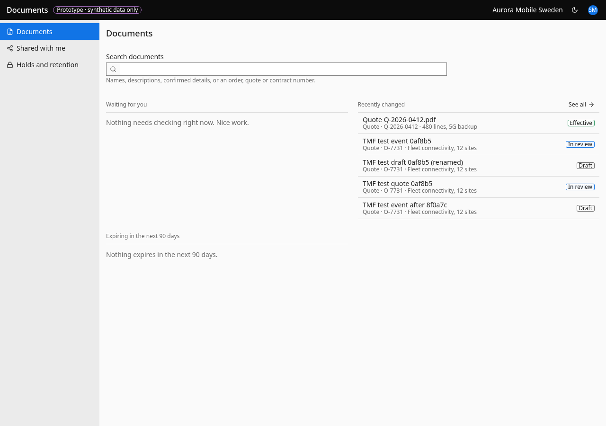

# Documents (search)

- **URL:** `/documents`
- **Who:** any signed-in person (results follow the visibility rule)

## Purpose
Search-first entry point for millions of documents (see 08).

## Layout and actions
Landing lists: "Waiting for you" (empty: "Nothing needs checking right now. Nice work."), "Recently changed" with See all, "Expiring in the next 90 days" (empty: "Nothing expires in the next 90 days."), and On legal hold (admins). The search hint reads: "Names, descriptions, confirmed details, or an order, quote or contract number." Search box (label "Search documents", "Clear search"); identifier-like queries show "Matching records" with Go to record. Filters persist in the URL (the search text is also in the URL in the prototype, `search-url.ts:24`, against the kit's Never list; the rebuild keeps search text out of the URL). The prototype uses two labels for the same command, "Clear all" (toolbar) and "Clear all filters" (empty state); one label is required (kit `AGENTS.md` § Copy), which one is the owner's decision. Sort (updated, name, expiry). Count label per BR-103, in a live region. Rows open the document in a side panel; the open row uses the table selected fill (`fill-cell-selected`, `DESIGN.md` cell family) with a 3 px `border-item-selected` bar and unchanged text colour (the prototype paints it `fill-item-selected` with `text-main`, 3.45:1 in light theme). Bulk: when every loaded row is ticked, "Select all N matching instead" starts a change on the whole result (BR-105–108); when the count is capped ("More than 10,000 documents") the whole result cannot be selected (BR-105) and the prototype's label "Select all More than 10,000 matching instead" must not be reproduced; the bulk bar refuses with "You can change up to 10,000 documents at once. Narrow the filters a little." Viewers see no selection column (the prototype shows it and hides the bulk bar). Saved views: personal for everyone; team views for the exact role tenant_admin (the prototype refuses master_admin, `search.functions.ts:144`; whether master_admin counts as admin here is the owner's decision).

## States
Route error (the page itself): "Documents couldn't load" / "Something interrupted the connection. Reloading the page usually helps." (no retry button). Loading: 6 skeleton rows for the route, 8 for results; count "Counting…", then the BR-103 label, or "Results" when the count fails. Results error: "The results couldn't load just now." + **Try again**. Empty: "No documents match" / "You can try fewer filters or a shorter word. Numbers like O-7731 also find the record itself." + **Clear all filters**. Paging: "Loading more…", then "That's everything for this search.". Facets: "Counts aren't available right now. Filters still work." on error; "None in these results" for an empty group. Landing lists: 3 skeleton rows; "This list couldn't load just now." + Try again; empties "Nothing needs checking right now. Nice work." / "Documents you can see will appear here as they change." / "Nothing expires in the next 90 days." / "No documents are on hold.". Record column: "Record you can't open" when the related record is hidden (the rebuild returns no record id in that case, BR-093; see 04). Bulk job: "Working… N of M checked. You can keep working; this carries on in the background."; done: the BR-107 summary + **Done**; failed: "The change stopped part-way. Everything already changed is in the activity log; you can start it again for the rest."

## Accessibility
- Every action is reachable by keyboard. Unavailable actions use `aria-disabled` and show the reason as visible text: "Save view" needs a name (the prototype shows no reason, `saved-views.tsx:63`).
- Results are a `grid` with a real header row (`columnheader` for Name, Record, Status, Changed; the prototype's header is `role="presentation"`), one Tab stop, Arrow/Home/End to move, Enter to open, Space to tick; the open row carries `aria-current="true"`, `aria-selected` reflects the checkbox; `aria-rowcount="-1"` while more pages can load. The selection cell is a 24×24 px hit area.
- Closing the panel returns focus to the row that opened it. Dialogs return focus to the control that opened them.
- Live regions: the count label, "Loading more…", the bulk job status.
- Status is never shown by colour alone; the hold indicator in a row is a tag or an icon with `role="img"` and a name (the prototype puts `aria-label` on a bare `<svg>`).
- Hover and selected rows keep every text at 4.5:1: `text-secondary` is never placed on `fill-item-hover` (3.94:1 light, 2.44:1 dark).

