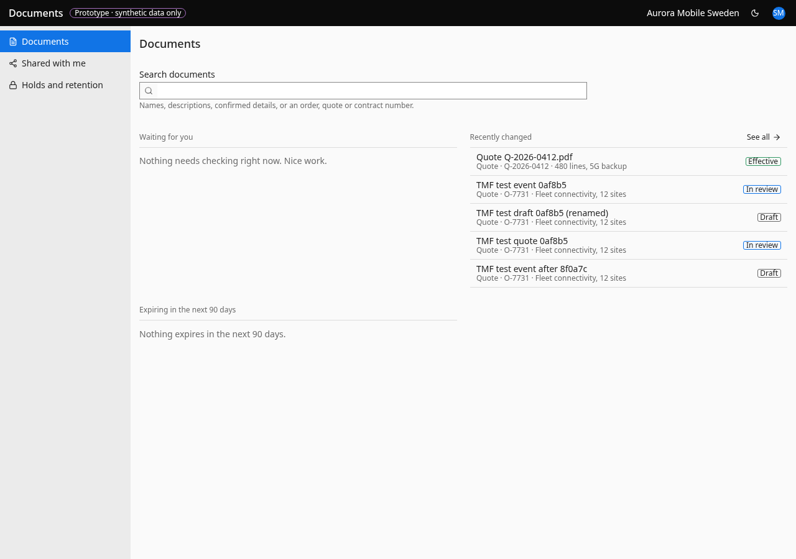
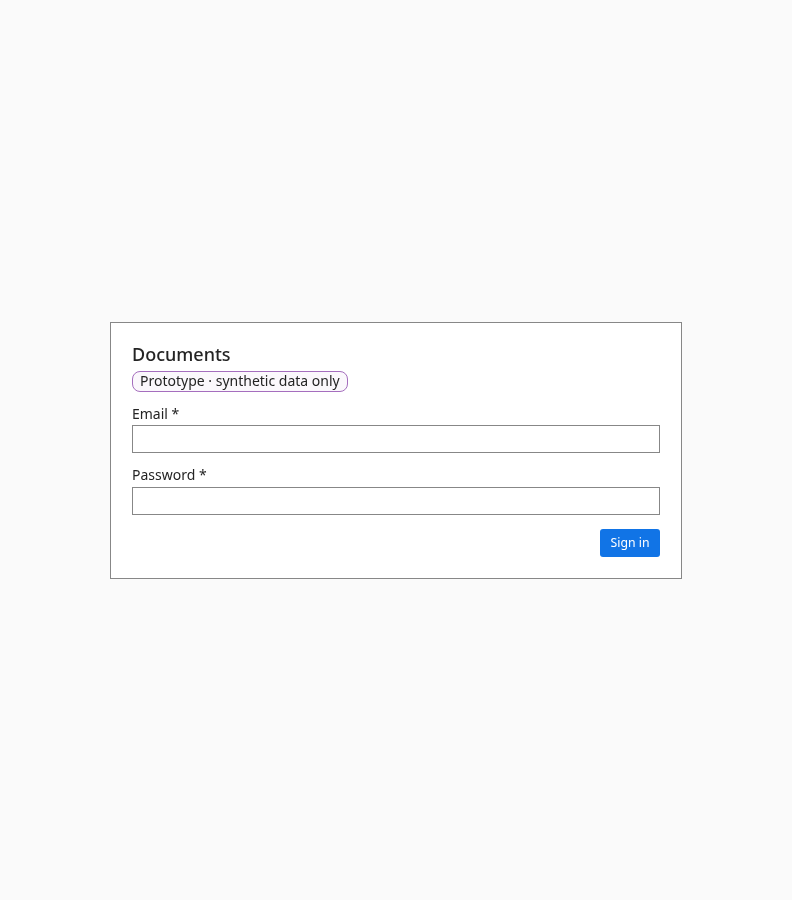

# Documents (search)

- **URL:** `/documents`
- **Who:** any signed-in person (results follow the visibility rule)

## Purpose
Search-first entry point for millions of documents (see 08).

## Layout and actions
Landing lists: for people who can review, "Details to check" and "Waiting for approval" (empty: "No document has details waiting to be checked." / "No document is waiting for approval."); for everyone, "Recently changed" with See all, "Expiring in the next 90 days" (empty: "Nothing expires in the next 90 days."), and On legal hold (admins). The search hint reads: "Names, descriptions, confirmed details, or an order, quote or contract number." Search box (label "Search documents", "Clear search"); identifier-like queries show "Matching records" with Go to record. Filters persist in the URL. Above the results one toolbar row holds the count (with the words searched for, BR-103), "Clear" when any filter is set (EDS terminology: Clear sets fields back to their initial value), and "Sort by" (updated, name, expiry). Rows open the document in a side panel. Select rows or all results to start a bulk change (BR-105–108). Saved views: personal, team views for admins.

## States
Loading: skeleton rows. Error: "Documents couldn't load" / "The results couldn't load just now." + **Try again**. Empty: "No documents match" + Clear.

## Accessibility
- Every action is reachable by keyboard. Unavailable actions use `aria-disabled` and show the reason as visible text.
- Dialogs return focus to the control that opened them. Targets are at least 24 px.
- Status is never shown by colour alone.

