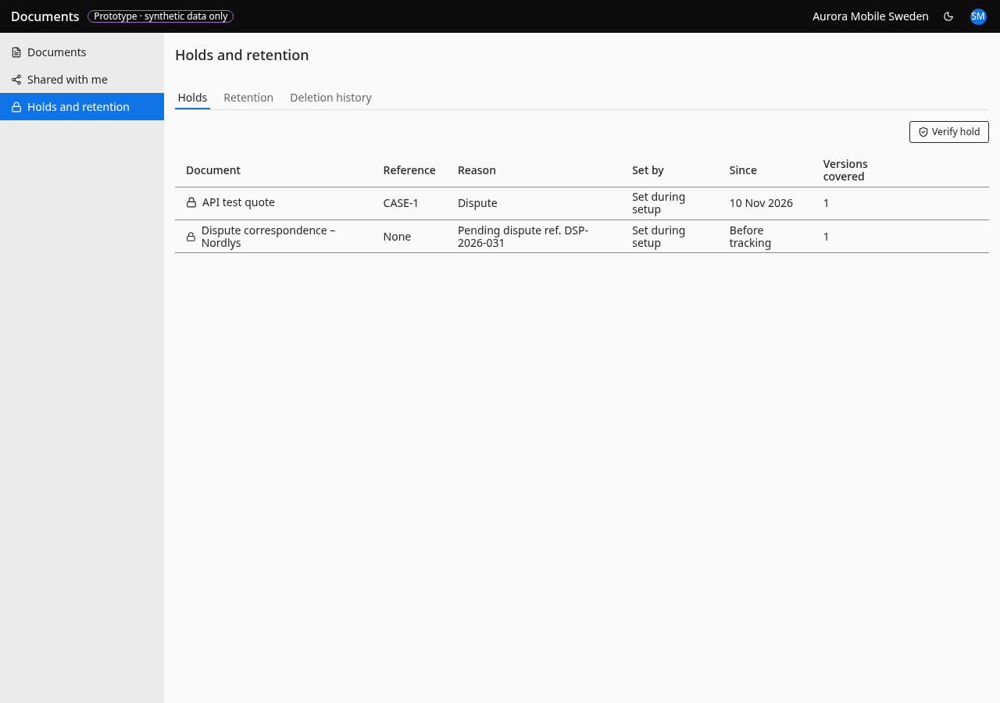

# Holds and retention

- **URL:** `/holds`
- **Who:** managers and admins (others: "Holds are managed by managers")

## Purpose
Documents under legal hold and retention overview for the tenant.

## Layout and actions
Three tabs. **Holds**: "Verify hold" button; table Document (lock icon; "Deleted" tag when soft-deleted), Reference ("None"), Reason ("None given"), Set by ("Set during setup" when unknown; the prototype also shows it for holds placed by a connected system, because the API path stores no setter), Since, Versions covered; a "Release" action per row, visible in the idle state (the prototype shows it on hover only); paging "1–20 of N" with Previous/Next. Release needs manage: dialog "Release legal hold" / "After release, the document follows its normal retention again and can be deleted once its keep-until date has passed." with "Reason for release" (required: "Required, so the history explains why."); Cancel / Release hold; toast "Legal hold released". Verification dialog "Hold verification" / "Every document and version currently under legal hold." lists name · reference and version · hash ("Checking holds…"; "No documents are on hold."); hashes are only evidence if computed server-side (the prototype stores the browser-asserted hash, see 04). **Retention**: table Policy, Where defined (BR-084 tag), Keep for ("Raised to N years by <group>" when the floor applies, BR-055), Documents; "Next expiries": "N documents reach retention end in the next 90 days. Nothing is deleted automatically." **Deletion history**: table Date, Requested by, Document, Result; "Restore" per restorable row; toast "Document restored".

## States
Per tab: skeleton while loading; errors "Holds didn't load" / "Retention didn't load" / "History didn't load" + "Something interrupted the connection." + Try again; empties "No documents are on hold" / "When a manager places a legal hold, it appears here with its reason." and "Nothing deleted in the last 30 days" / "Deleted documents appear here for 30 days, so you can restore them.". Prototype-only sentences (see README): "Retention periods here are demo values…", "The content store is not locked in this prototype."

## Accessibility
- Every action is reachable by keyboard. Unavailable actions use `aria-disabled` and show the reason as visible text.
- Dialogs return focus to the control that opened them. Targets are at least 24 px.
- Status is never shown by colour alone.

