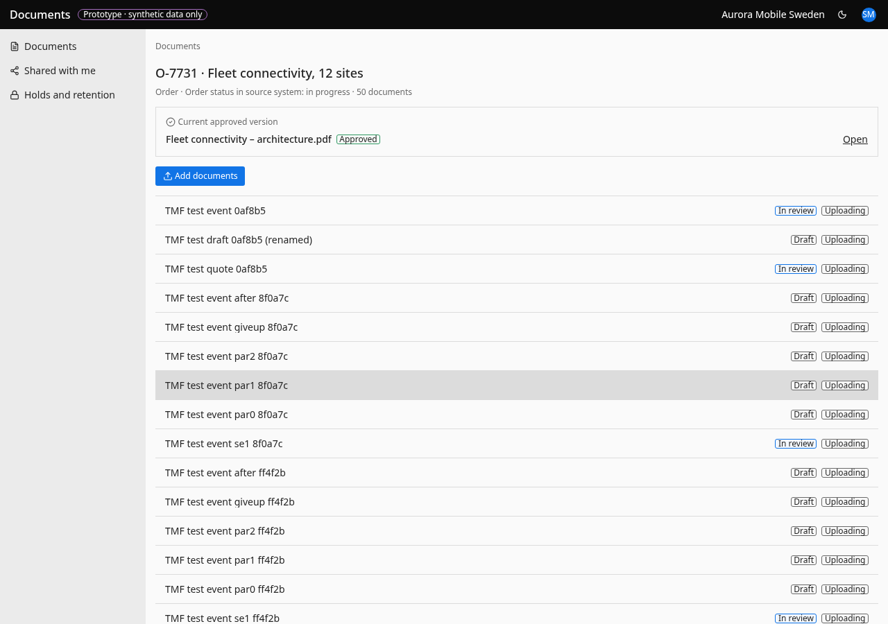
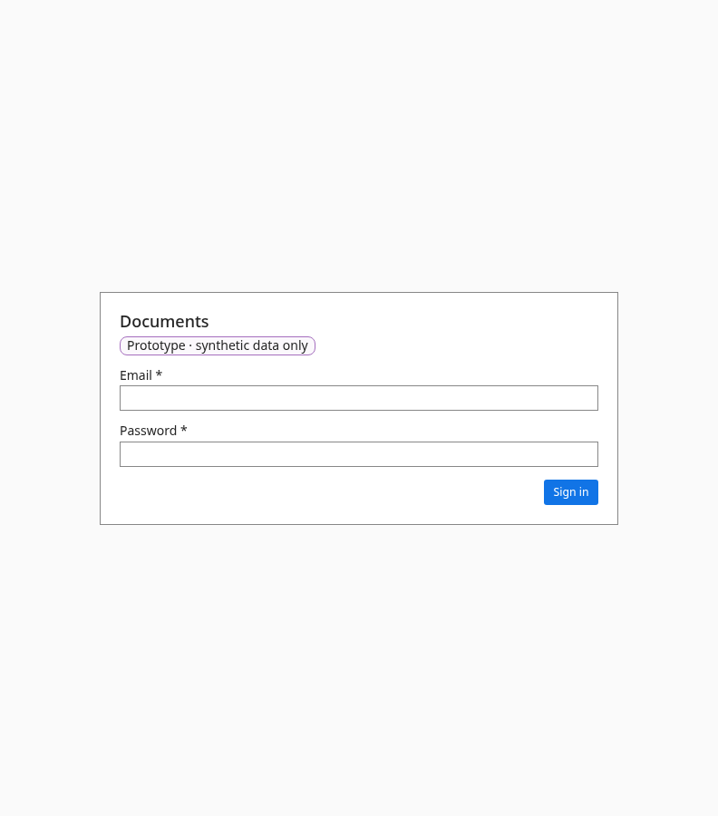

# Record

- **URL:** `/records/{entityId}`
- **Who:** people with access to the record, and tenant admins

## Purpose
Shows one telecom record (order, quote, account…) and its documents. Header shows the record type, id, name and "<kind> status in source system: …". This status belongs to the source system, not to the document.

## Layout and actions
Summary of current approved/effective documents (max 3, "Show all", BR-017), then the documents as a table (Name with "n to check", Type, Status with hold and processing tags, Changed); Name, Type and Changed sort (the whole header is the target), newest change first by default. The count is above the table and EDS pagination below it, 25 per page; dates are ISO (2026-11-10) and a missing value is an em dash. Add documents by dropping files or using the add button (upload rules BR-062–069); the global drop guard stops the browser opening files. The document panel shows the journey (Check details → Approve → Effective) and one primary action: "Check details" while a required detail blocks Approve (with "Approve is available after you check n required details." under it, tied to the link), otherwise the next step. Send back, holds, delete and the other actions are in "More actions". An action the person's role can never take is not shown; one blocked by the document (a hold, a keep-until date, details to check, their own document) stays with its reason (BR-014–016, 051–052). It also shows versions, activity, Manage access, and "Why can I see this?" (BR-092).

## States
Not available: "This record isn't available to you" (no detail leaked). Empty: "No documents on this record yet" + add action. "Back to documents".

## Accessibility
- Every action is reachable by keyboard. Unavailable actions use `aria-disabled` and show the reason as visible text.
- Dialogs return focus to the control that opened them. Targets are at least 24 px.
- Status is never shown by colour alone.

