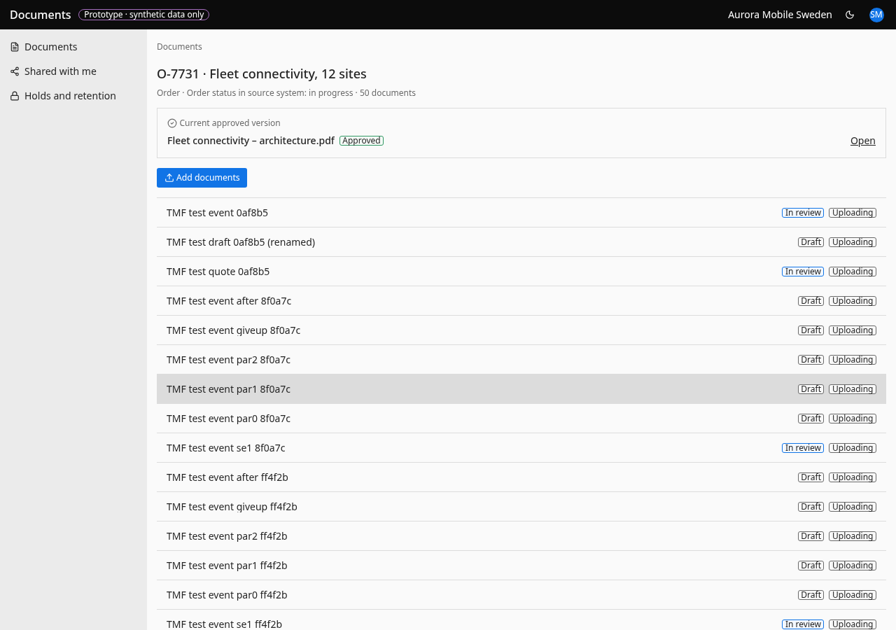

# Record

- **URL:** `/records/{entityId}`
- **Who:** people with access to the record, and tenant admins

## Purpose
Shows one telecom record (order, quote, account…) and its documents. Header shows the record type, id, name and "<kind> status in source system: …". This status belongs to the source system, not to the document.

## Layout and actions
Summary of current approved/effective documents (max 3, "Show all", BR-017), then in review, then all documents. Add documents by dropping files or using the add button (upload rules BR-062–069); the global drop guard stops the browser opening files. The document panel shows the journey (Check details → Approve → Effective), next step, actions with reasons (BR-014–016, 051–052), versions, activity, Manage access, and "Why can I see this?" (BR-092).

## States
Not available: "This record isn't available to you" (no detail leaked). Empty: "No documents on this record yet" + add action. "Back to documents".

## Accessibility
- Every action is reachable by keyboard. Unavailable actions use `aria-disabled` and show the reason as visible text.
- Dialogs return focus to the control that opened them. Targets are at least 24 px.
- Status is never shown by colour alone.

