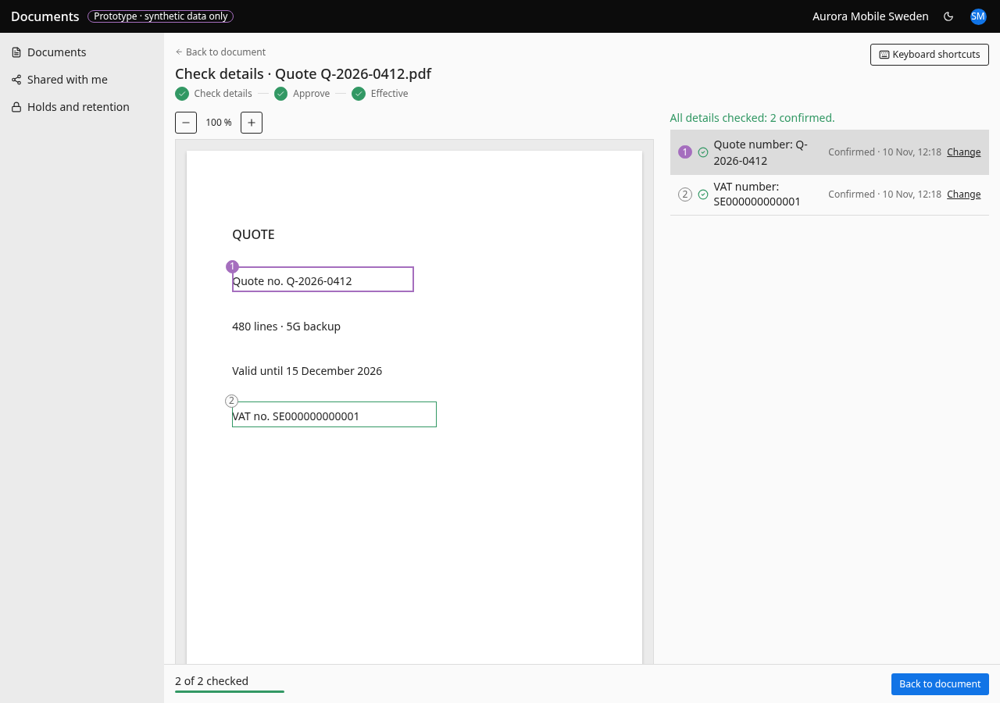

# Check details

- **URL:** `/records/{entityId}/review/{docId}`
- **Who:** reviewers and above with record access (others read only: "Only reviewers and managers can check details. You can still read them.")

## Purpose
Guided confirmation of details read from a document before approval.

## Layout and actions
Left: page preview with numbered markers (page order BR-033), zoom. Right: "Details read from the document". Pending rows show value, plain reason (BR-039), source line, Confirm / Correct, and "Not in this document" under the … menu; contract-critical rows are tagged "Needed for approval". Checked rows collapse to one line with a tick, the time, and Change. Sticky footer "N of M checked" with progress and the action from BR-025 (Next detail → Approve document → Back to document) and its reason. Outcome per BR-026. Under 900 px: tabs **Details** / **Document**; choosing a marker jumps to Details. Keyboard: J/K or arrows to move, C confirm, E correct, N next; listed under **Keyboard shortcuts**.

## States
Frozen: "This document is closed, so its checked details are kept as they are." Empty: "Nothing to check here". Error: "We couldn't open the details just now." + Try again. Not visible: "This document isn't available to you".

## Accessibility
- Every action is reachable by keyboard. Unavailable actions use `aria-disabled` and show the reason as visible text.
- Dialogs return focus to the control that opened them. Targets are at least 24 px.
- Status is never shown by colour alone.

