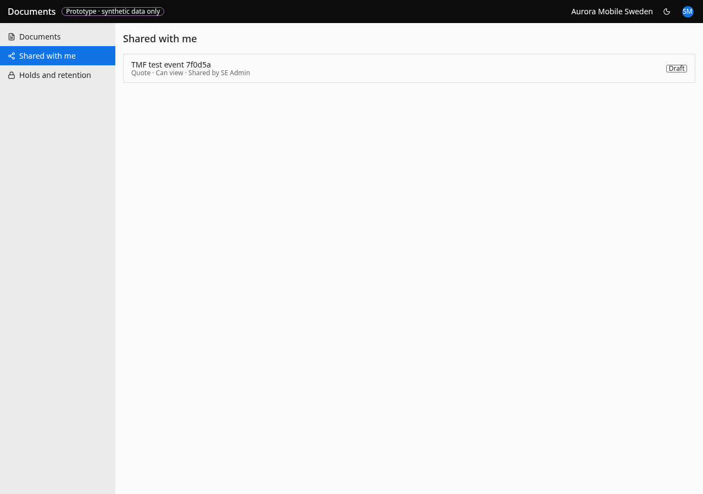
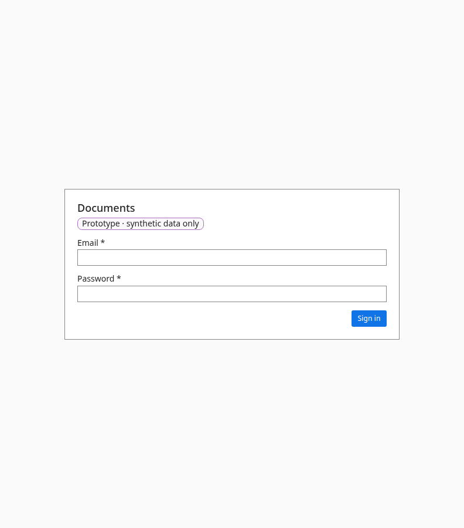

# Shared with me

- **URL:** `/shared and /shared/{docId}`
- **Who:** any signed-in person

## Purpose
Documents shared directly with the person, even without access to the parent record.

## Layout and actions
List with paging (Previous/Next). Opening a document shows the document panel without record details. Record links appear only if the person can read that record (BR-093). Actions are capped by the share level (BR-004). "Back to Shared with me".

## States
Loading: 4 skeleton rows. Empty: "Nothing shared yet" / "Nothing has been shared with you yet. When someone shares a document directly, it will appear here." Error: "We couldn't load your shared documents just now." + Try again. Row meta: "<Type> · Can view|Can edit · Shared by <name> · Until <date>". Paging: Previous / "Page N of M" / Next, unavailable at the ends with the page label as the visible reason. A removed share makes the direct link show "This document isn't available to you, or it has been removed." at once (BR-094). The share level narrows what the screen offers (`?level=`), but the server enforces the cap (BR-004); the prototype's server does not (see 04 and the review).

## Accessibility
- Every action is reachable by keyboard. Unavailable actions use `aria-disabled` and show the reason as visible text.
- Dialogs return focus to the control that opened them. Targets are at least 24 px.
- Status is never shown by colour alone.

