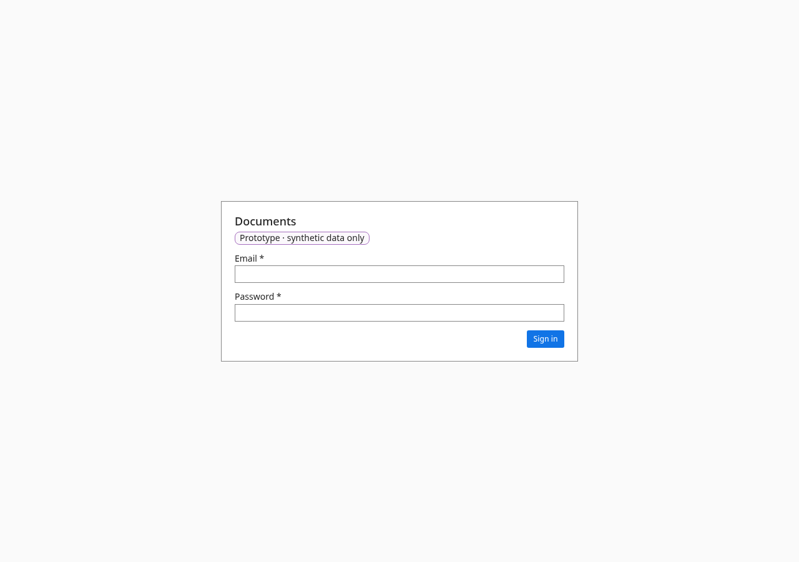

# Sign in

- **URL:** `/auth`
- **Who:** everyone (signed out)

## Purpose
Email and password sign-in for the prototype. In the rebuild this becomes the Keycloak login page with the same tone and branding.

## Layout and actions
Fields: Email, Password; button **Sign in**. Badge "Prototype · synthetic data only". After sign-in, return to the `redirect` URL.

## States
Busy: the button reads "Signing in…" and is unavailable. Error, on the password field: "That email and password did not match. You can try again." (never the raw error; the error is announced to assistive technology). Breach-protected passwords are refused with the same message (a Keycloak policy in the rebuild).

## Accessibility
- Every action is reachable by keyboard. Unavailable actions use `aria-disabled` and show the reason as visible text.
- Dialogs return focus to the control that opened them. Targets are at least 24 px.
- Status is never shown by colour alone.

