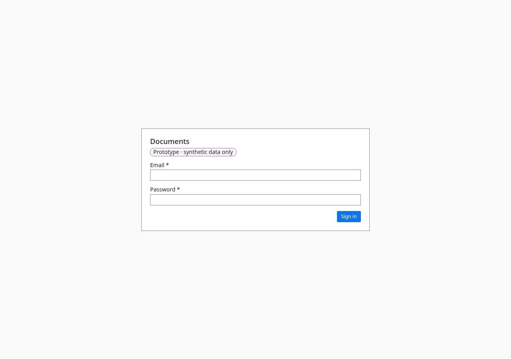

# Log in

- **URL:** `/auth`
- **Who:** everyone (logged out)

## Purpose
Email and password log in for the prototype (EDS sign in pattern; the action is "Log in" in EDS terminology). In the rebuild this becomes the Keycloak login page with the same tone and branding.

## Layout and actions
Always on a dark background, whatever the theme. Product name, badge "Prototype · synthetic data only", fields Email and Password, primary button **Log in**, and the legal warning in the footer (Ericsson security requirement; the text is configurable). After log in, return to the `redirect` URL. **Log out** is in the account menu; it returns here with "You have logged out. Log in again to continue."

## States
Error: one generic message that does not say whether the email exists, never the raw error. Breach-protected passwords are refused.

## Accessibility
- Every action is reachable by keyboard. Unavailable actions use `aria-disabled` and show the reason as visible text.
- Dialogs return focus to the control that opened them. Targets are at least 24 px.
- Status is never shown by colour alone.

